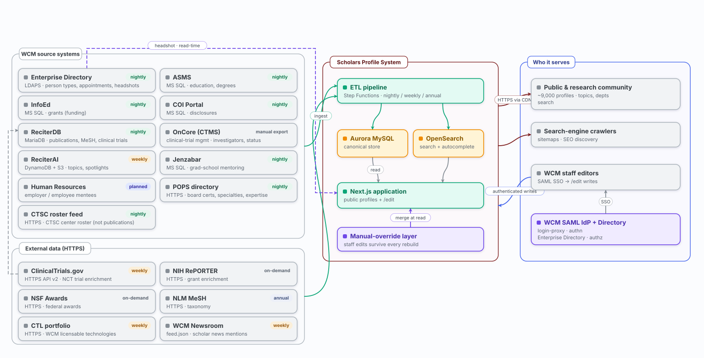

# SPS Operations Runbook

Scholars Profile System · Weill Cornell Medicine · scholars.weill.cornell.edu

| | | | |
|---|---|---|---|
| **Last updated** | **2026-11-09** | **Version** | 2.0 |
| **Owner** | Paul Albert, SPS service owner (paa2013@med.cornell.edu) | **Next review** | 2027-02-09 (quarterly) |
| **Audience** | Anyone responding to an SPS issue: ITS Operations, on-call staff, SPS engineers | **Checked against** | Repo commit `bca752e` (2026-11-09): `cdk/lib/*`, `docs/SLOs.md`, `docs/oncall.md`, `docs/cloudfront-cache-spec.md` |

> [!IMPORTANT]
> **Start here**
>
> 1. Find what you're seeing in the [Triage table](#triage-what-are-you-seeing).
> 2. Open the matching playbook in Part 2 and work through its steps in order.
> 3. If the steps don't resolve it, escalate using [Contacts and escalation](#contacts-and-escalation).
>
> Doing planned work (a deploy, scaling, clearing a cache)? Go to [Part 3: Planned operations](#part-3-planned-operations).

> [!WARNING]
> **The one rule to remember: stale is not down**
>
> Almost everything on a profile is a snapshot that a scheduled job (the ETL) copies from WCM source systems. When a source system fails, SPS keeps serving the last good copy. **If pages load, even with old or missing data, you have a data freshness problem, not an outage.** Don't roll back, restart or scale for it; go to the data playbooks (6 to 11).

> [!NOTE]
> **When sources disagree**
>
> The linked deep docs win over this runbook, and the CDK code (`cdk/lib/*`) wins over any doc. If you find drift, fix this runbook and update **Last updated** above.

## Contents

**[Part 1. Triage, severity and contacts](#part-1-triage-severity-and-contacts)**

- [Triage: what are you seeing?](#triage-what-are-you-seeing)
- [Severity levels](#severity-levels)
- [Contacts and escalation](#contacts-and-escalation)
- [Key facts at a glance](#key-facts-at-a-glance)

**[Part 2. Incident playbooks (1 to 19)](#part-2-incident-playbooks)**

**[Part 3. Planned operations](#part-3-planned-operations)**

**[Part 4. Monitoring reference](#part-4-monitoring-reference)**

**[Part 5. System reference](#part-5-system-reference)**

**[Appendix A. Glossary](#appendix-a-glossary)**

**[Appendix B. Open items and known risks](#appendix-b-open-items-and-known-risks)**

**[Appendix C. Where to find more](#appendix-c-where-to-find-more)**

**[Appendix D. Revision history](#appendix-d-revision-history)**

## Part 1. Triage, severity and contacts

### Triage: what are you seeing?

Find the closest match and go to its playbook. The severity tells you how fast to move ([Severity levels](#severity-levels)).

| What you're seeing | Severity | Go to |
|---|---|---|
| **The site is down, erroring or slow** | | |
| Site down: 5xx errors, "Something went wrong", blank pages. Teams card `sps-app-unavailable` | P1 | [Playbook 1](#1-the-site-is-down-or-returning-errors-p1) |
| `sps-edge-origin-down` or `sps-edge-unreachable`, while ALB and ECS alarms are quiet | P1 | [Playbook 2](#2-edge-or-origin-problem-cloudfront-netscaler-p1-p2) |
| `sps-edge-origin-cert-expiring` or `sps-edge-probe-stalled` | P2 | [Playbook 2](#2-edge-or-origin-problem-cloudfront-netscaler-p1-p2) |
| Pages are slow: `sps-alb-latency-p99` or `sps-edge-origin-latency-p99` | P1 / P2 | [Playbook 3](#3-pages-are-slow-p1-p2) |
| 500s with "pool timeout": `sps-db-pool-timeout` or `sps-aurora-connections` | P1 / P2 | [Playbook 4](#4-database-connections-exhausted-p1-p2) |
| Database load warning: `sps-aurora-cpu` or `sps-aurora-acu` | P2 | [Playbook 5](#5-database-under-heavy-load-p2) |
| **The site is up, but data is old or wrong** | | |
| One profile still shows old content after an edit or ETL run | Low | [Playbook 6](#6-one-profile-shows-old-content-low) |
| A whole section (grants, publications, appointments…) is old or missing across many profiles | P2 | [Playbook 7](#7-a-section-is-stale-across-many-profiles-p2) |
| Teams card naming an ETL alarm (`-status`, `-cadence`, `-duration`, heartbeat, reconcile, backup…) | P2 | [Playbook 8](#8-an-etl-alarm-arrived-in-teams-p2) |
| ETL log says `[etl-guard:<name>] … refusing to proceed` | P2 | [Playbook 9](#9-an-etl-safety-guard-refused-to-run-p2) |
| A retracted paper is still showing, or a paper disappeared | Low | [Playbook 10](#10-a-retracted-paper-is-still-showing-low) |
| Home page "Selected research" is empty, has wrong authors, or has broken links | Low | [Playbook 11](#11-home-page-selected-research-is-wrong-low) |
| **Search** | | |
| `sps-opensearch-cluster-red`, `-jvm-pressure` or `-breaker`; search requests failing | P1 / P2 | [Playbook 12](#12-search-cluster-unhealthy-p1-p2) |
| A search returns nothing or far too few results | Low | [Playbook 13](#13-search-returns-too-few-results-low) |
| Search results are stale after a data load or a mapping change | Low | [Playbook 14](#14-rebuild-the-search-index-low) |
| **Login and editing** | | |
| Staff can't log in to `/edit`, or `sps-edit-authz-denied` fired | P2 | [Playbook 15](#15-staff-cant-log-in-or-are-denied-on-edit-p2) |
| `/api/revalidate` returns 401 or 500 | P2 | [Playbook 16](#16-apirevalidate-returns-401-or-500-p2) |
| **Alerting, backups and recovery** | | |
| An alarm fired but no Teams card arrived within 5 minutes, or an `sps-oncall-relay-errors` email | Urgent | [Playbook 17](#17-an-alarm-fired-but-no-teams-card-arrived-urgent) |
| Data is lost or corrupted in the database (not an app bug), or a backup job failed | P1 | [Playbook 18](#18-data-loss-or-corruption-restore-the-database-p1) |
| AWS us-east-1 regional outage | P1 | [Playbook 19](#19-aws-us-east-1-regional-outage-p1) |
| Budget or cost-anomaly email | Notify | Not an incident. See [Cost guardrails](#cost-guardrails) |

### Severity levels

| Level | What it means | Examples | Where it arrives | Expected response |
|---|---|---|---|---|
| **P1** page | Users are affected right now | Site down, p99 over 1.5 s, search cluster red, DB pool timeouts, edge origin down, an abort-tier ETL step failed | Primary SPS Teams channel | Respond now. Formal target: TBD in OLA |
| **P2** warn | Early warning, or data going stale. The site still serves | Aurora CPU, capacity or connections; OpenSearch memory; edit 403 bursts; every ETL and reconciler alarm; origin cert expiring | "Warn" Teams channel. Falls back to the primary channel until the warn webhook secret exists | Same or next business day |
| **Notify** | Not a service incident (except relay errors) | Budget and cost-anomaly alerts; `sps-oncall-relay-errors` | Email to the service owner | Cost: review. Relay errors: act now, alerts are being lost |
| **P0** | A deliberate full outage | Using the kill switch on prod | Not applicable | Tell active operators before you do it |

> [!WARNING]
> **Off-hours gap (accepted risk)**
>
> Alerting is Teams and email only. There is no SMS, no phone paging and no acknowledgment tracking, so nobody is woken up automatically. A future option is registering SPS as a ServiceNow CI in an escalation group.

### Contacts and escalation

> [!IMPORTANT]
> **Ownership after launch is unresolved**
>
> The likely owner is ITS management. Until that is settled, the service owner below is the only on-call operator. Fill in the TBD rows before publishing this runbook to the WCM Internal KB.

| Area | Contact | How to reach |
|---|---|---|
| SPS service owner; production deploy approver | Paul Albert | paa2013@med.cornell.edu; GitHub `paulalbert1`; mobile TBD |
| Operations owner after launch | TBD (likely ITS management) | TBD |
| ServiceNow assignment group | TBD | TBD |
| SPS Teams channels (primary and warn) | TBD: record channel names | Microsoft Teams |
| Login: SAML IdP and Enterprise Directory (LDAPS) | WCM Identity & Access Management | TBD |
| Network: NetScaler VIP, origin certificate, Transit Gateway, WCM firewall (Central Services account `091981818184`) | WCM networking | TBD |
| Upstream data: ReCiter and ReciterAI | TBD | TBD |
| Upstream data: InfoEd, COI Portal, ASMS, Jenzabar | Source system owners | TBD |
| CTSC roster feed | CTSC | TBD |
| AWS | AWS Support (tier and Sev-1 case path TBD) | AWS console |
| Business stakeholders | TBD | TBD |
| Telling users about an outage | Recommended: ITS Alert plus email | its.weill.cornell.edu |

> [!WARNING]
> **Single point of failure in alerting**
>
> The Power Automate workflow that posts alerts to Teams belongs to its creator's Microsoft account. If that person leaves WCM, alerting stops without warning. Check every quarter that the workflow owner is still here.

### Key facts at a glance

| Item | Production | Staging |
|---|---|---|
| Public URL | https://scholars.weill.cornell.edu | https://scholars-staging.weill.cornell.edu |
| AWS account and region | `665083158573`, us-east-1 (DR: us-west-2) | Same account and region, separated by name prefix |
| ECS cluster / service | `sps-cluster-prod` / `sps-app-prod` | `sps-cluster-staging` / `sps-app-staging` |
| Normal task count | 2 (autoscales up to 6) | 1 (up to 3) |
| Reliability dashboard | `sps-reliability-prod` | `sps-reliability-staging` |
| App logs | `/aws/ecs/sps-app-prod` | `/aws/ecs/sps-app-staging` |
| ETL logs | `/aws/ecs/sps-etl-prod` | `/aws/ecs/sps-etl-staging` |
| CloudFront distribution | `E28NKDFXC7K2ZL` | `E17NRWINXLP3B3` |
| Aurora cluster | `sps-data-prod-auroraclusterfromsnapshot7b6a45d8-ylbuldcja7bm` | `sps-data-staging-auroraclusterfromsnapshot7b6a45d8-8kp4eh79cfrn` |
| OpenSearch domain | `opensearchshare-hr8gdfznbeww` | `opensearchshare-mhshucea3jvk` |
| Monitoring tools | New Relic (live APM); CloudWatch (alarms, long-term history) | Same |

> [!TIP]
> **How commands in this runbook are written**
>
> Commands use `$ENV` for the environment. Set it first: `export ENV=prod` (or `staging`). In running text, `<env>` means the same thing, for example `sps-app-<env>`. Other `<angle brackets>` are values you fill in.
>
> Confirm which AWS account you're in before you change anything: `aws sts get-caller-identity`.

## Part 2. Incident playbooks

Every playbook has the same shape: what you'll see, what it means, the steps in order, what not to do, and where to escalate. Each alarm's Teams card also carries a short "Next:" hint written in the CDK code; these playbooks expand on it.

### 1. The site is down or returning errors `P1`

| | |
|---|---|
| **You'll see** | Teams card `sps-app-unavailable-<env>`. It fires when any of these is in alarm: ALB 5xx rate over 1%, zero healthy hosts, ECS task shortfall, edge origin down, or edge unreachable. Users see 5xx errors, "Something went wrong", or blank pages. |
| **What it means** | The serving path is broken. The usual causes are a bad deploy, a database problem (often connection exhaustion), or a fault in front of the app (NetScaler or CloudFront). Error pages are never cached at the edge, so pages that aren't already cached fail first. |

**DO THIS**

1. Open the `sps-reliability-<env>` dashboard and note which underlying alarm fired.
2. If **only** the edge alarms fired (`sps-edge-origin-down`, `sps-edge-unreachable`) and the ALB and ECS look healthy, go to [Playbook 2](#2-edge-or-origin-problem-cloudfront-netscaler-p1-p2).
3. If Aurora CPU or connections are also high, suspect connection-pool exhaustion: go to [Playbook 4](#4-database-connections-exhausted-p1-p2).
4. Did it start right after a deploy? Roll back if, for 5 minutes or more, the ALB 5xx rate is 1% or higher **or** p95 latency is at least twice the pre-deploy baseline. See [Roll back an app deploy](#roll-back-an-app-deploy).
5. If tasks keep dying (task shortfall), read the ECS service events for image-pull, capacity or IAM failures:

   ```bash
   aws ecs describe-services --cluster sps-cluster-$ENV --services sps-app-$ENV \
     --query 'services[0].events[:10].[createdAt,message]' --output table
   ```

6. Otherwise, pull the app logs for the failing route from `/aws/ecs/sps-app-<env>` and decide whether to roll back or fix forward.
7. Need to take the site offline right now? Use the [kill switch](#restart-stop-start-and-scale). On prod this is a P0: tell active operators first.

**DON'T**

- Roll back database migrations. They are additive only; always fix forward.
- Roll back by re-running the deploy workflow from an older commit. That re-runs the migration step.

**ESCALATE**

Service owner. For NetScaler or network faults, WCM networking.

**More detail:** [rollback-runbook.md](./rollback-runbook.md) · [error-handling-spec.md](./error-handling-spec.md) · [dependency-outage-matrix.md](./dependency-outage-matrix.md) · [app-aws-topology.svg](./architecture/app-aws-topology.svg)

### 2. Edge or origin problem (CloudFront, NetScaler) `P1` `P2`

| | |
|---|---|
| **You'll see** | P1: `sps-edge-origin-down-<env>` (a synthetic probe couldn't get a 200 through NetScaler VIP, ALB and ECS for 15 minutes) or `sps-edge-unreachable-<env>` (CloudFront isn't answering at the public hostname: DNS or TLS failed). The ALB and ECS alarms stay quiet. P2: `sps-edge-origin-cert-expiring-<env>` (origin certificate expires in under 30 days) or `sps-edge-probe-stalled-<env>` (the probe has stopped running). |
| **What it means** | The fault is in front of the app. The NetScaler VIP is the only origin for dynamic pages and it has **no failover**. The ALB and ECS alarms can't see this because requests never reach the ALB. Meanwhile CloudFront keeps serving pages it already has cached. |

**DO THIS**

1. **Edge unreachable:** check DNS for the public alias, the viewer certificate's expiry, and that the CloudFront distribution is Enabled and Deployed.
2. **Origin down:** check the NetScaler VIP (WCM networking), then the ALB port 443 listener and its priority-1 `X-Origin-Verify` rule (a rotated secret looks exactly like an outage), then the origin certificate.
3. If the VIP stays down, run the **origin backout**: clear `edgeOriginHostname` in `cdk/lib/config.ts` and deploy `Sps-Edge-<env>` on its own, following [Change CloudFront safely](#change-cloudfront-edgestack-safely). Traffic then goes http-only to the ALB on port 80. Note: this backout hasn't been rehearsed on staging yet.
4. **Origin cert expiring:** ask WCM networking to rotate it. The certificate is not in ACM and does not renew itself. When it expires, every dynamic request returns 502.
5. **Probe stalled:** check errors on the Lambda function `sps-edge-origin-probe-<env>` and its EventBridge schedule. This is a monitoring gap, not an outage, but the origin alarms are blind until it's fixed.

**DON'T**

- Point the CloudFront origin at the ALB DNS name with https-only in the console. The certificate won't match and every request returns 502.
- Run a bare `cdk deploy` on EdgeStack. It strips the WAF, the certificate and the custom domain.

**ESCALATE**

WCM networking (NetScaler VIP, origin certificate, Transit Gateway).

**More detail:** [Origin backout](./network-security-topology.md#origin-backout-netscaler-vip-to-alb-1936) · [edge-topology-fork.svg](./architecture/edge-topology-fork.svg)

### 3. Pages are slow `P1` `P2`

| | |
|---|---|
| **You'll see** | P1: `sps-alb-latency-p99-<env>` (p99 response time over 1.5 s for 15 minutes; P1 in prod, P2 warn in staging). P2: `sps-edge-origin-latency-p99-<env>` (CloudFront's round trip to the origin over 20 s at p99). |
| **What it means** | The latency SLO is burning. Above 20 s at the origin, requests are close to CloudFront's 30-second timeout, after which users get 504 errors that the app logs as successes. |

**DO THIS**

1. On the `sps-reliability-<env>` dashboard, compare ALB latency, CloudFront origin latency and Aurora `SelectLatency`.
2. **ALB fast but CloudFront origin slow:** the delay is in the NetScaler hop. Contact WCM networking.
3. **ALB slow:** find the slow route. Check Bedrock-backed API routes first. The Athena saved query `sps-perf-slow-routes-<env>` gives p50, p95 and p99 by route ([Usage and performance analytics](#usage-and-performance-analytics)).
4. Look for a slow query, a cold cache or an undersized task. Trace a slow request with X-Ray (see [tracing.md](./tracing.md)).

**DON'T**

- Raise CloudFront's `OriginReadTimeout` until WCM networking confirms the NetScaler timeout.

**ESCALATE**

Service owner; WCM networking if the delay is in the NetScaler hop.

**More detail:** [tracing.md](./tracing.md) · [performance-baseline.md](./performance-baseline.md)

### 4. Database connections exhausted `P1` `P2`

| | |
|---|---|
| **You'll see** | P1: `sps-db-pool-timeout-<env>` (any "pool timeout" in the app logs). P2: `sps-aurora-connections-<env>` (over 70 connections for 10 minutes). Users get 500s with `pool timeout: failed to retrieve a connection from pool`. |
| **What it means** | Aurora is at its connection limit (about 90). Normal peak is 60. The cause is almost always a **leaked connection pool**: a one-off run-task probe or script that imported `@/lib/db` and never called `await db.$disconnect()`. It prints its output in seconds, then sits in `RUNNING` holding 15 connections. |

**DO THIS**

1. If the log line says `active=0 idle=0`, the database itself is at its limit. **Restarting the app will not help.**
2. List running one-off tasks (repeat with the other ETL families if needed, see [Run a one-off ETL task](#run-a-one-off-etl-task)):

   ```bash
   aws ecs list-tasks --cluster sps-cluster-$ENV --family sps-etl-$ENV --desired-status RUNNING
   ```

3. For each task, confirm it's a finished probe (still `RUNNING` long after it printed its results) and not a live ETL run or evaluation.
4. Stop the leftover tasks. Read-only probes are safe to stop:

   ```bash
   aws ecs stop-task --cluster sps-cluster-$ENV --task <task-arn>
   ```

5. Watch Aurora `DatabaseConnections` drain from about 90 back to normal in roughly 3 minutes. The app recovers on its own.

> [!NOTE]
> **Staging and prevention**
>
> Staging has two Aurora clusters and the idle one reads 0 connections. Look at the `...auroraclusterfromsnapshot...` cluster.
>
> To prevent this, one-off tasks must call `$disconnect` and run under a `timeout 600` wrapper.

**ESCALATE**

Service owner.

**More detail:** [performance-baseline.md](./performance-baseline.md)

### 5. Database under heavy load `P2`

| | |
|---|---|
| **You'll see** | `sps-aurora-cpu-<env>` (CPU over 80% for 15 minutes in prod, 30 minutes in staging) or, in prod only, `sps-aurora-acu-<env>` (writer capacity use over 80% for 15 minutes). |
| **What it means** | Either a runaway query (CPU), or the cluster is near its capacity ceiling (8 ACU in prod, 4 in staging). Aurora Serverless reports CPU as a share of *current* capacity, so a maxed-out cluster can still show low CPU. That is why the capacity alarm exists. |

**DO THIS**

1. Check Performance Insights or the slow-query log for the expensive query.
2. Compare `ServerlessDatabaseCapacity` with the cluster's maximum, and line up the time window against the nightly ETL (starts 07:00 UTC).
3. Raise the maximum (`auroraMaxCapacity` in `cdk/lib/config.ts`, applied with an [infrastructure change](#apply-an-infrastructure-or-feature-flag-change)) only if the load is legitimate.

**ESCALATE**

Service owner.

**More detail:** [performance-baseline.md](./performance-baseline.md)

### 6. One profile shows old content `Low`

| | |
|---|---|
| **You'll see** | A single profile still shows old content after an edit or an ETL run. |
| **What it means** | Since 2026-10-02 a profile page is cached in two places: a copy at the origin (refreshed at least every 6 hours) and a copy at the CloudFront edge (60 seconds, but CloudFront may keep serving its older copy while it fetches a new one). Edits and the nightly and weekly ETL clear both automatically; the edge purge goes out through the CDN reconciler every 5 minutes. A stale profile can come from bad data, the origin copy or the edge copy. |

Work from the data toward the viewer:

**DO THIS**

1. **Data.** Query the row in prod Aurora (`scripts/run-staging-probe.sh <probe> prod`). If the database is wrong, it's an ETL or source problem: go to [Playbook 7](#7-a-section-is-stale-across-many-profiles-p2).
2. **Origin.** Fetch the page and read the cache headers. `x-nextjs-cache: HIT` with a recent age and the right content means the origin copy is fresh.

   ```bash
   curl -sI https://scholars.weill.cornell.edu/<slug> | grep -iE 'x-nextjs-cache|x-cache|^age'
   ```

3. **Edge.** `x-cache: Hit from cloudfront` with an `age` well over 60 means CloudFront served an older copy. Check that the newest row in the `cdn_invalidation` table has `invalidated_at` set. A pending row with a rising `attempts` count means the reconciler can't purge (check its IAM permissions and the distribution ID).
4. **Fix.** To clear one profile everywhere, make any `/edit` change to it, or invalidate it at the edge:

   ```bash
   aws cloudfront create-invalidation --distribution-id <dist-id> --paths "/<slug>"
   ```

Other pages: departments and centers refresh every 6 hours, topics every 2 hours, and static assets are cached up to a year.

**DON'T**

- Use `POST /api/revalidate?path=/scholars/<slug>`. That path is the old URL, which now only redirects; clearing it does nothing for the profile.
- Expect `/api/revalidate` alone to fix what users see. It clears only the origin copy, never the edge copy.

**ESCALATE**

Service owner if the reconciler is failing.

**More detail:** [cloudfront-cache-spec.md](./cloudfront-cache-spec.md#profile-pages-isr-at-the-origin-cached-at-the-edge)

### 7. A section is stale across many profiles `P2`

| | |
|---|---|
| **You'll see** | Pages load, but a section (publications, grants, appointments, education…) shows old or missing data for many people. |
| **What it means** | The ETL source that feeds that section stopped refreshing, and SPS is serving the last good snapshot. A "Topics updating" placeholder is normal for about 30 minutes while the reciter to dynamodb steps run. |

| Section | Comes from | Refreshed |
|---|---|---|
| People, titles, appointments, org units | Enterprise Directory (LDAPS) | Nightly (runs first) |
| Publications, MeSH terms, citations | ReciterDB (MariaDB) | Nightly (about 5 min) |
| Grants | InfoEd (MS SQL) | Nightly |
| Conflict of interest disclosures | COI Portal (MS SQL) | Nightly |
| Education | ASMS (MS SQL) | Nightly |
| PhD mentoring | Jenzabar (MS SQL) | Weekly |
| Topics, scores, spotlight, methods and tools | ReciterAI (DynamoDB and S3 JSON) | Nightly |
| CTSC center roster | CTSC investigators and trainees feed | Nightly |
| NIH and NSF funding detail | NIH RePORTER, NSF | Weekly |
| MeSH vocabulary | NLM MeSH | Yearly (July 1) |

**DO THIS**

1. Find the last good run for the source:

   ```sql
   SELECT source, status, completed_at, rows_processed, error_message
   FROM etl_run WHERE source = '<Source>'
   ORDER BY started_at DESC LIMIT 5;
   ```

2. If it failed, read the error and check for an ETL alarm ([Playbook 8](#8-an-etl-alarm-arrived-in-teams-p2)). If the WCM source system itself is down, SPS can't fix it: contact the source owner.
3. Once the source is reachable, re-run it with `npm run etl:<ed|reciter|infoed|coi|asms|jenzabar|dynamodb|spotlight>` as a [one-off task](#run-a-one-off-etl-task). Re-runs are safe to repeat. `etl:ed` must succeed first because everything else depends on it.

**ESCALATE**

The owner of the source system (see [Contacts](#contacts-and-escalation)).

**More detail:** [dependency-outage-matrix.md](./dependency-outage-matrix.md) · [data-population-runbook.md](./data-population-runbook.md)

### 8. An ETL alarm arrived in Teams `P2`

| | |
|---|---|
| **You'll see** | A card naming `sps-etl-<cadence>-status`, `-cadence`, `-duration`, `sps-etl-heartbeat-status`, `sps-etl-duration-margin`, `sps-etl-retry-storm`, or a job alarm such as `sps-reconcile-*`, `sps-cdn-reconcile-*`, `sps-curation-backup-*`, `sps-honors-status` or `sps-grants-export-*`. Failures in the critical steps (Ed, Dynamodb, SearchIndex, Integrity) arrive as **P1** on the primary channel. |
| **What it means** | **Status:** a run didn't finish cleanly (it failed, timed out or was stopped). **Cadence:** a run that should have started didn't. **Duration:** a run is taking longer than usual. **Heartbeat:** runs look green but the data is still stale. |

**DO THIS**

1. Read the card's Description and its "Next:" line.
2. In the Step Functions console, open `scholars-<cadence>-<env>` and its newest execution. The red step shows what failed and why.
3. Read that step's logs in `/aws/ecs/sps-etl-<env>`.
4. Confirm the effect on data with the `etl_run` query in [Playbook 7](#7-a-section-is-stale-across-many-profiles-p2).
5. Common causes: a WCM source is unreachable (not fixable from SPS), an EventBridge rule is disabled, a source returned nothing, or a safety guard tripped ([Playbook 9](#9-an-etl-safety-guard-refused-to-run-p2)).
6. Once fixed, resume the chain from the failed step:

   ```bash
   aws stepfunctions start-execution --state-machine-arn <arn> \
     --input '{"startFrom":"<StepId>"}'
   ```

> [!NOTE]
> **Good to know**
>
> - Prod schedules have been enabled since 2026-07-07, so a missing run is a fault.
> - The yearly run has no cadence alarm; it is tracked by calendar.
> - Some steps (for example the CTSC roster and roster prominence) are "continue-tier": a failure keeps last night's data and doesn't fail the run. The freshness heartbeat is their only safety net.

**ESCALATE**

Source system owner if the source is down; otherwise the service owner.

**More detail:** [etl-monitoring.md](./etl-monitoring.md) · [ETL schedules](#etl-schedules)

### 9. An ETL safety guard refused to run `P2`

| | |
|---|---|
| **You'll see** | An ETL step fails with `[etl-guard:<name>] … refusing to proceed`, for example `ed:scholar-soft-delete` reporting a large number of departures. |
| **What it means** | A safety check tripped because the source returned far fewer records than the database holds. **Nothing was written or deleted.** Either the source really shrank or changed shape (in 2026-06 the Enterprise Directory moved students to `ou=students,ou=sors`), or a real backlog of departures built up while nightly runs were failing. |

**DO THIS**

1. **Verify before bypassing.** Reproduce the affected set read-only and spot-check a sample in the source. For the ED example: if every one is LDAP `faculty:expired` and none are active, the departures are genuine.
2. **Not genuine:** fix how the data is fetched. Don't bypass. (PR #1456 shows how the ED fetch was repointed.)
3. **Genuine:** run the step once as a [one-off task](#run-a-one-off-etl-task) with the environment variable `ETL_GUARD_BYPASS="<guard-name>"`, set through `containerOverrides.environment`. Separate several guards with commas.
4. Confirm the next nightly run is clean.

**DON'T**

- Set the bypass permanently, or use `ETL_GUARD_BYPASS="all"` unless you have checked every guard.

**ESCALATE**

Service owner.

**More detail:** [Guard reference for CTSC and roster prominence](#job-specific-notes) · [data-population-runbook.md](./data-population-runbook.md)

### 10. A retracted paper is still showing `Low`

| | |
|---|---|
| **You'll see** | A retracted paper is still visible on a profile, or a paper disappeared. |
| **What it means** | Retraction *notices* are always hidden. The *original* article stays visible as a Journal Article until the nightly `PubMedRetractions` step re-labels it as Retraction (which hides it) and rebuilds search. In prod this runs automatically every night. |

**DO THIS**

1. Check that the `PubMedRetractions` step ran in the latest nightly execution.
2. If it stopped, check that the ETL schedule rules are enabled:

   ```bash
   aws events list-rules --name-prefix sps-etl- --query 'Rules[].[Name,State]' --output table
   ```

3. A manual run is normally unnecessary: `npm run etl:pubmed-retractions`, then [rebuild the search index](#14-rebuild-the-search-index-low).

> [!WARNING]
> **Known hazard (#1512)**
>
> Prod's config once said schedules were disabled while they were actually enabled. The config now says enabled, but the mismatch only fully closes after the next `Sps-Etl-prod` deploy. Until then, a deploy that touches a schedule rule could silently disable the nightly run. Check rule state after any `Sps-Etl-prod` deploy.

**ESCALATE**

Service owner.

**More detail:** [retracted-publications.md](./retracted-publications.md)

### 11. Home page "Selected research" is wrong `Low`

| | |
|---|---|
| **You'll see** | The "Selected research" section is empty or hidden, shows the wrong authors, or has links that return 404. |
| **What it means** | The spotlight data didn't change, too few items survived the display minimum, authors couldn't be matched, or links have the wrong shape. |

**DO THIS**

1. Check the newest `Spotlight` row in `etl_run`: `status = 'success'` and `rows_processed > 0`. A 0 means the input was unchanged (normal), not a failure.
2. Run `SELECT COUNT(*) FROM spotlight;` (expect 25 or fewer). If fewer than 6 survive, the section hides itself (`SPOTLIGHT_FLOOR=6`).
3. Authors only appear when their `cwid` is not null.
4. Browse links must look like `/topics/{parent}?subtopic={sub}`.
5. To fix the content, re-publish it in ReciterAI (`python3 backfill_spotlight.py --publish`), then run `npm run etl:spotlight`.

**ESCALATE**

ReciterAI owner for content problems.

**More detail:** [spotlight-runbook.md](./spotlight-runbook.md)

### 12. Search cluster unhealthy `P1` `P2`

| | |
|---|---|
| **You'll see** | P1: `sps-opensearch-cluster-red-<env>` (shards unassigned). P2: `sps-opensearch-jvm-pressure-<env>` (memory pressure over 85%) or `sps-opensearch-breaker-<env>` (OpenSearch refused queries with `circuit_breaking_exception`, so those searches returned 500). |
| **What it means** | Only search and autocomplete are affected. Profiles and other pages read from Aurora, not OpenSearch, so they keep working. |

**DO THIS**

1. Check `JVMMemoryPressure` (Maximum), shard count and query load in the OpenSearch console and on the dashboard.
2. **Memory pressure or breaker:** the nodes are undersized, or a burst of heavy queries (for example the sponsor-match fan-out) is too much for the heap. Throttle the heavy query or scale the domain.
3. **Cluster red:** check shard allocation in the OpenSearch console. The index is rebuilt from Aurora and isn't backed up, so a fresh [index rebuild](#14-rebuild-the-search-index-low) restores the data.

**ESCALATE**

Service owner.

**More detail:** [SLOs.md](./SLOs.md#alarm-catalog)

### 13. Search returns too few results `Low`

| | |
|---|---|
| **You'll see** | A search returns nothing, or far too few people. Known examples: `covid19` finds 9 people but `covid-19` finds 1,425; `tylenol` finds 0. |
| **What it means** | Either (A) letters and digits glued together, like `covid19`, are indexed as one word (#725), or (B) MeSH concept matching only affects ranking and never adds results (#726). |

**DO THIS**

1. Reproduce and note the total:

   ```bash
   curl -s -G https://scholars.weill.cornell.edu/api/search \
     --data-urlencode q=<term> --data-urlencode type=people | jq .total
   ```

2. **Cause A:** the fix is the `alnum_delimiter` analyzer **plus** an index rebuild, shipped together. Glued terms stay broken until the index is rebuilt.
3. **Cause B:** the fix is a code change to admit results on `publicationMeshUi` when word matches are sparse.
4. Then [rebuild the index](#14-rebuild-the-search-index-low).

**ESCALATE**

Service owner (code change needed).

**More detail:** [search-recall.md](./search-recall.md)

### 14. Rebuild the search index `Low`

| | |
|---|---|
| **You'll see** | Search results are stale, missing or wrong after a mapping or analyzer change, or after a data load. |
| **What it means** | The index needs a rebuild outside the normal schedule. The rebuild builds a new index and then swaps the `scholars` alias over in one step, so a failed rebuild never empties live search. |

**DO THIS**

1. Look up the current ETL subnet and security group IDs as described in [data-population-runbook.md](./data-population-runbook.md) section 3. **Never hardcode them:** the VPC move changed both, and old IDs launch into a dead network and time out.
2. Start the rebuild:

   ```bash
   aws ecs run-task --cluster sps-cluster-$ENV --task-definition sps-etl-$ENV \
     --launch-type FARGATE \
     --network-configuration "awsvpcConfiguration={subnets=[$ETL_SUBNETS],securityGroups=[$ETL_SG],assignPublicIp=DISABLED}" \
     --overrides '{"containerOverrides":[{"name":"etl","command":["npm","run","search:index"]}]}'
   ```

3. Watch progress in `/aws/ecs/sps-etl-<env>`.

Note: a rebuild doesn't yet refresh cached pages (#479, #353), so pages can lag search until their cache expires.

**ESCALATE**

Service owner.

**More detail:** [data-population-runbook.md](./data-population-runbook.md) · [network-topology.svg](./architecture/network-topology.svg)

### 15. Staff can't log in, or are denied, on /edit `P2`

| | |
|---|---|
| **You'll see** | Logging in to `/edit` fails, with callback errors such as `idp_status_error`, `invalid_saml_response`, `no_cwid` or `Responder`, and log events `saml_callback_failed` or `superuser_check_failed`. Or the alarm `sps-edit-authz-denied-<env>` (more than 10 edit 403s in 5 minutes, twice in a row). |
| **What it means** | Editing is affected; the public site is not. |
| **Likely cause** | `idp_status_error`: a problem at the WCM SAML identity provider.<br>`superuser_check_failed`, or everyone denied: Enterprise Directory (LDAPS) unreachable. Permissions fail closed, so a directory outage blocks all editing.<br>`invalid_saml_response`: the IdP certificate changed, or `SAML_IDP_CERT` is wrong.<br>`no_cwid`: the IdP isn't releasing the CWID attribute.<br>`Responder`: `SAML_SP_ENTITY_ID` doesn't match.<br>A burst of 403s: a permissions bug in the last deploy, or someone probing. |

**DO THIS**

1. Find the failures in the app logs (CloudWatch Logs Insights on `/aws/ecs/sps-app-<env>`):

   ```
   fields @timestamp, @message
   | filter @message like /saml_callback_failed|superuser_check_failed/
   | sort @timestamp desc | limit 50
   ```

2. **Certificate problem:** `SAML_IDP_CERT` (secret `scholars/<env>/saml/idp-cert`) holds one or more PEM certificates joined together. Fixing it is an environment change plus a [restart in place](#restart-stop-start-and-scale); no code change.
3. Test the fix on staging. Staging uses the production IdP.
4. **403 burst:** review the `edit_authz_denied` log events for the user and path, and compare with the last deploy.

> [!NOTE]
> **Break-glass and certificate status**
>
> There is no way to bypass SSO (by design). To grant emergency superuser access, add the person's CWID to the ED group `ITS:Library:Scholars/superuser-role`. This needs the directory to be reachable.
>
> The old IdP signing certificate expired on 2026-08-19; its successor is valid until 2036-03-27. **Confirm** the expired certificate was removed from `SAML_IDP_CERT` (that cleanup was due 2026-08-26).

**ESCALATE**

WCM Identity & Access Management for IdP or directory faults.

**More detail:** [saml-sp.md](./saml-sp.md) · [access-control-rbac.md](./access-control-rbac.md)

### 16. /api/revalidate returns 401 or 500 `P2`

| | |
|---|---|
| **You'll see** | The ETL revalidate step, or another caller, gets 401 or 500 from `POST /api/revalidate`. |
| **What it means** | 500 `server misconfigured`: `SCHOLARS_REVALIDATE_TOKEN` isn't set. 401: the token is missing or wrong, or the header isn't `Authorization: Bearer`. 401 during a token rotation: the app is still using the old token, because it only re-reads tokens when it restarts. |

**DO THIS**

1. In secret `scholars/revalidate-token`, set both `SCHOLARS_REVALIDATE_TOKEN` (new) and `SCHOLARS_REVALIDATE_TOKEN_PREVIOUS` (old).
2. Redeploy or [restart the app](#restart-stop-start-and-scale) so it reads both.
3. Switch the ETL callers to the new token.
4. Confirm both tokens return 200.
5. After at least 24 hours, remove the previous token and restart the app again.

**ESCALATE**

Service owner.

**More detail:** [revalidate-token-rotation.md](./revalidate-token-rotation.md)

### 17. An alarm fired but no Teams card arrived `Urgent`

| | |
|---|---|
| **You'll see** | An alarm is in ALARM but no card reached Teams within 5 minutes, or an email from `sps-oncall-relay-errors-<env>`. |
| **What it means** | The alert path (CloudWatch, SNS, the relay Lambda, Power Automate, Teams) is broken. Usual causes: the webhook URL in the secret is out of date, the Power Automate workflow was disabled or its owner left, or the alarm never actually reached ALARM. **Until this is fixed, you won't hear about other incidents.** |

**DO THIS**

1. Check whether the relay is losing alerts:

   ```bash
   aws cloudwatch describe-alarms --alarm-names "sps-oncall-relay-errors-$ENV" \
     --query 'MetricAlarms[0].StateValue'
   ```

2. If it's ALARM, lost alerts are waiting in the SQS queue `sps-oncall-relay-dlq-<env>`; each message is one original alarm. Read them. The alarm clears when the queue is empty.
3. Read the relay's recent log:

   ```bash
   aws logs tail "/aws/lambda/sps-oncall-relay-$ENV" --since 10m --follow
   ```

   - `delivered status:202`: the relay worked; the problem is on the Teams side.
   - `upstream_error 4xx/5xx`: the Power Automate workflow rejected the post.

4. Check the workflow's run history in Power Automate.
5. Check the webhook URL secret:

   ```bash
   aws secretsmanager get-secret-value --secret-id "scholars/$ENV/oncall/teams-webhook-url"
   ```

6. Confirm the original alarm really reached ALARM. `INSUFFICIENT_DATA` doesn't notify anyone.
7. Confirm the page topic has exactly one subscription, with `Protocol: lambda`:

   ```bash
   aws sns list-subscriptions-by-topic --topic-arn <ARN of sps-alarms-$ENV>
   ```

**DON'T**

- Subscribe the workflow URL to SNS directly (`aws sns subscribe --protocol https`). Power Automate rejects SNS's format with HTTP 400; that is why the relay exists.

**ESCALATE**

Service owner. If the workflow owner has left WCM, the workflow must be recreated under a current account.

**More detail:** [oncall.md](./oncall.md#diagnostics-test-alarm-fires-but-no-teams-message)

### 18. Data loss or corruption: restore the database `P1`

| | |
|---|---|
| **You'll see** | Data is wrong or missing in Aurora itself (not an app bug), or a Teams card (P2) from `sps-aws-backup-failure-<env>` saying a backup or cross-region copy job failed. |
| **What it means** | This is outside what an app rollback can fix. Targets: lose no more than 24 hours of data (RPO) and recover within 4 hours (RTO). Both restore methods were tested on **2026-11-09** and passed: point-in-time restore and full row-count validation took 17 minutes; a DR-vault restore to a running database in us-west-2 took 12 minutes (passed on the AWS side; checking the data was deferred because there is no compute in us-west-2). |

| Option | Restores to | Where |
|---|---|---|
| **A. Point-in-time restore (PITR)** | Any moment in the last 14 days | Same region, from Aurora's continuous backup |
| **B. DR vault snapshot** | A daily snapshot (35 kept in prod, 14 in staging) | us-west-2, vault `sps-dr-backup-vault-<env>` |
| Daily AWS Backup snapshot | A daily snapshot (35 days in prod, 14 in staging) | us-east-1, vault `sps-backup-vault-<env>` |

**DO THIS**

1. Decide the restore point: the last moment the data was known to be good.
2. **Option A:** restore to a new cluster, then add a `db.serverless` writer instance (about 20 to 40 minutes in total):

   ```bash
   aws rds restore-db-cluster-to-point-in-time \
     --source-db-cluster-identifier <cluster> \
     --db-cluster-identifier <new-cluster> \
     --use-latest-restorable-time  # or --restore-to-time <UTC timestamp>
   ```

3. **Option B:** follow Variant B in [restore-drill-runbook.md](./restore-drill-runbook.md).
4. Validate row counts and cut over as described in [restore-drill-runbook.md](./restore-drill-runbook.md).

Both backup vaults have an AWS Backup Vault Lock (governance mode, minimum retention equal to the plan's: 35 days in prod, 14 in staging), so recovery points can't be deleted early without first removing the lock.

**Backup-failure alert.** A failed, aborted or expired AWS Backup job or cross-region copy job for the SPS cluster is caught by the EventBridge rule `sps-aws-backup-failure-<env>` (in `Sps-Etl-<env>`), which posts to `etl-failures-<env>` and arrives in Teams as a P2 failure card. Copy jobs report in the source region, so the one us-east-1 rule covers both vaults. Check the job in the AWS Backup console, fix the cause, and confirm the next daily job (05:00 UTC) and its copy succeed.

**ESCALATE**

Service owner.

**More detail:** [restore-drill-runbook.md](./restore-drill-runbook.md)

### 19. AWS us-east-1 regional outage `P1`

| | |
|---|---|
| **You'll see** | AWS reports a us-east-1 regional outage affecting ECS, Aurora or the load balancers. |
| **What it means** | There is no automatic failover. CloudFront keeps serving pages it has cached, and other requests get the branded maintenance page. Because SPS is read-mostly and no other WCM system depends on it, recovery can be **scheduled rather than rushed**. Only the database restore has been tested in us-west-2; rebuilding the rest of the stack there has not. |

**DO THIS**

1. Restore the database from the DR vault into a us-west-2 network (Option B in [Playbook 18](#18-data-loss-or-corruption-restore-the-database-p1)), applying the TLS parameter group and Serverless scaling settings.
2. Point the CDK at the DR region (`region` in `cdk/lib/config.ts`) and deploy in this order: network, data (importing the restored cluster), app, ETL. Prod app and ETL images are already copied to us-west-2 ECR (registry replication, set up by `Sps-Data-prod`), and the curated-tables backup is copied to an S3 bucket there (`Sps-DrBackupVault-<env>`).
3. Rebuild the search index ([Playbook 14](#14-rebuild-the-search-index-low)). OpenSearch isn't backed up; it's rebuilt from Aurora.
4. Point CloudFront at the new load balancer (see the [origin backout](./network-security-topology.md#origin-backout-netscaler-vip-to-alb-1936)) and ask WCM networking to restore connectivity to the ETL source systems (Transit Gateway, NetScaler).

**ESCALATE**

Service owner, WCM networking, AWS Support.

**More detail:** [restore-drill-runbook.md](./restore-drill-runbook.md) · [network-security-topology.md](./network-security-topology.md)

## Part 3. Planned operations

### How changes reach production

There are three separate ways a change ships. Mixing them up is the most common operator mistake.

| What changed | How it ships | Who starts it |
|---|---|---|
| App code (the container image) | GitHub Actions `deploy.yml` rolls out a new image | Automatic on push to `master` (staging). Manual dispatch plus approval (prod) |
| Infrastructure, feature flags, environment variables (`cdk/lib/*`) | `cdk deploy Sps-App-<env>` | A person, never CI |
| CloudFront (EdgeStack) | `cdk deploy Sps-Edge-<env>` on its own | A person. Deliberately kept out of `deploy.yml` |

> [!WARNING]
> **What a push to master does not do**
>
> It deploys **only the staging app image**. It doesn't update CloudFront, doesn't apply CDK or flag changes, and doesn't touch prod: prod stays behind master until someone dispatches a prod deploy. A flag set in `.env.local` but not wired into `app-stack.ts` ships silently **off**.

#### Ship to staging (automatic)

Merging to `master` runs `deploy.yml` against staging. It takes about 7 to 9 minutes without a migration. The steps run in this order:

1. Build the image and push app and ETL images to ECR.
2. Pin new task-definition revisions to this deploy's exact image digests.
3. Sync `.next/static` to S3.
4. Run db-bootstrap, then verify database grants, then run `prisma migrate deploy`. **These three are gates:** if any fails, the deploy stops and the service is not changed.
5. Point the ECS service at the new pinned revision and wait until it is stable.

#### Promote to production

**BEFORE YOU START: ALL MUST BE TRUE**

- [ ] `cdk diff` is clean (the workflow does **not** run it for you):

  ```bash
  cd cdk && npx cdk diff --exclusively Sps-App-prod -c env=prod \
    -c appImageDigest=$(../scripts/release/running-app-digest.sh prod)
  ```

- [ ] The same commit has been on staging within the last 72 hours.
- [ ] No Prisma migrations in the diff that haven't been tried on staging.
- [ ] Someone is on call for the next 30 minutes.
- [ ] You can open log groups `/aws/ecs/sps-app-prod` and `/aws/ecs/sps-migrate-prod` without signing in again.

**THEN**

1. Start the deploy (or in GitHub: Actions, Deploy, Run workflow, branch `master`, env `prod`):

   ```bash
   gh workflow run deploy.yml --ref master -f env=prod
   ```

2. The run waits in **Awaiting approval**. The required reviewer (`paulalbert1`) clicks **Approve and deploy**.
3. Watch until the service is stable, then check the dashboard and alarms ([health check](#routine-health-check)).

> [!IMPORTANT]
> **How prod is protected**
>
> Three controls: the `prod` GitHub Environment (only `master`, plus a required reviewer), a workflow step that refuses prod from any other branch, and the AWS sign-in claim that only accepts the prod environment on `master`.
>
> Two traps: until the `prod` Environment has at least one required reviewer, a prod dispatch runs **without** approval. And `gh api -X PUT .../environments/<name>` replaces the whole configuration, so always resend `deployment_branch_policy` or you wipe the master-only rule.

#### Apply an infrastructure or feature-flag change

```bash
cd cdk
# keep the running image pinned
digest=$(../scripts/release/running-app-digest.sh $ENV)
# 1. check the change is what you expect
npx cdk diff --exclusively Sps-App-$ENV -c env=$ENV -c appImageDigest="$digest"
# 2. apply it
npx cdk deploy --exclusively Sps-App-$ENV -c env=$ENV -c appImageDigest="$digest"
```

- Without `appImageDigest` the new revision points at the moving `:latest` tag. For prod, the CDK refuses to build.
- Adding a new flag to `app-stack.ts` also needs a refreshed snapshot, or the CDK test in CI fails: `cd cdk && npm ci && npm test -- -u`, then commit only the `.snap` file.
- `cdk deploy` and secret changes are run by the AWS account holder with their own credentials, never automatically.

#### Change CloudFront (EdgeStack) safely

> [!WARNING]
> **A bare `cdk deploy` of EdgeStack strips the WAF, the certificate and the custom domain**
>
> Always run the diff with `--strict` and every context flag, and confirm it destroys **nothing**: no WebACL, IPSet, Aliases or ViewerCertificate. If a change adds a new reference between stacks, deploy `Sps-App-<env>` **first**, then `Sps-Edge-<env>`.

```bash
npx cdk diff --strict --exclusively Sps-Edge-$ENV \
  -c env=$ENV -c edgeCustomDomain=<domain> \
  -c edgeCertArn=<acm-arn-in-us-east-1> \
  -c edgeAllowedCidrs=<WCM campus CIDRs, from SSM /sps/<env>/edge/allowed-cidrs>
# confirm: no destroy or Removed lines. Then:
npx cdk deploy --require-approval never --exclusively Sps-Edge-$ENV <same -c flags>
```

### Restart, stop, start and scale

Cluster `sps-cluster-<env>`, service `sps-app-<env>`. Normal size: prod 2 tasks (up to 6), staging 1 task (up to 3).

**Restart in place** (same image, fresh tasks; re-reads secrets):

```bash
aws ecs update-service --cluster sps-cluster-$ENV \
  --service sps-app-$ENV --force-new-deployment
```

**Kill switch** (take the site offline):

```bash
aws ecs update-service --cluster sps-cluster-$ENV \
  --service sps-app-$ENV --desired-count 0
```

Drains all tasks in about 30 seconds; CloudFront then returns 503. **On prod this is a P0: tell active operators first.**

**Start again** after the kill switch:

```bash
aws ecs update-service --cluster sps-cluster-$ENV \
  --service sps-app-$ENV --desired-count 2  # 1 for staging
```

- **Autoscaling** is attached only when the desired count is above 0. It targets 60% CPU and 1,000 requests per task (scale out after 60 s, scale in after 300 s). Both numbers are placeholders until load testing (#554).
- **Rolling deploys** keep 100% of tasks healthy, allow up to 200%, give new tasks 120 s to pass health checks, and roll back automatically if they fail.

### Roll back an app deploy

**When:** for 5 minutes or more, the ALB 5xx rate is at least 1%, **or** p95 latency is at least twice the pre-deploy baseline. It takes about 4 to 6 minutes.

1. Find the previous task-definition revision (the deployment that was `PRIMARY` before this one):

   ```bash
   aws ecs describe-services --cluster sps-cluster-$ENV --services sps-app-$ENV \
     --query 'services[0].deployments[].[status,taskDefinition,createdAt]' --output table
   ```

2. Point the service back at it:

   ```bash
   aws ecs update-service --cluster sps-cluster-$ENV --service sps-app-$ENV \
     --task-definition sps-app-$ENV:<previous-revision>
   ```

3. Watch the dashboard until errors and latency return to normal.

> [!WARNING]
> **A rollback does not cover**
>
> - Database migrations: they are additive only, so fix forward.
> - Data problems: use [Playbook 18](#18-data-loss-or-corruption-restore-the-database-p1).
> - CloudFront: use an invalidation ([Clear caches](#clear-caches)).
> - The OpenSearch index: rebuild it ([Playbook 14](#14-rebuild-the-search-index-low)).
>
> Never roll back by re-running the deploy workflow from an older commit: it re-runs migrations.

### Clear caches

| You want to… | Do this |
|---|---|
| Refresh one profile everywhere | Make any `/edit` change to it, or `aws cloudfront create-invalidation --distribution-id <dist-id> --paths "/<slug>"` |
| Refresh every profile | Happens automatically after the nightly and weekly ETL (origin plus edge). To force it, revalidate `/(public)/[slug]` and invalidate `/*` |
| Refresh a department, center, topic, home, about, browse or sitemap page at the origin | `POST /api/revalidate?path=<path>` with `Authorization: Bearer <token>` (token in secret `scholars/revalidate-token`). Served on the internal load balancer |
| Clear the CloudFront edge | `aws cloudfront create-invalidation`. Use sparingly; `/api/revalidate` never clears the edge |

### Run a one-off ETL task

ETL scripts run in five task-definition families, split so each holds only the credentials it needs. **Pick the family that has the secrets your script reads**, or the task fails at start with a missing key. The authoritative mapping is `LDAP_SCRIPTS`, `SOURCES_SCRIPTS`, `RECITER_API_SCRIPTS` and `CTSC_SCRIPTS` in [`cdk/lib/etl-stack.ts`](../cdk/lib/etl-stack.ts).

| Family | Use when the script… | Scripts |
|---|---|---|
| `sps-etl-<env>` (base) | Uses public APIs, AWS or only the SPS database | `search:index`, `backup:curated`, `etl:dynamodb`, `etl:identity`, `etl:spotlight`, `etl:hierarchy`, `etl:scholar-tool`, `etl:mesh-*`, `etl:pubmed-retractions`, `etl:reporter-grants`, `etl:nsf`, `etl:gates`, `etl:nih-profile`, `etl:pops`, `etl:news`, `etl:technologies`, `etl:revalidate`, `etl:integrity`, `etl:completeness`, `etl:headshot`, `etl:freshness`, `etl:coi-gap`, `etl:roster-prominence`, `etl:ed:import-email-visibility` |
| `sps-etl-sources-<env>` | Reads a WCM database | `etl:reciter`, `etl:reciter:coi-statements`, `etl:orcid-candidates`, `etl:orcid-evidence`, `etl:fundable-work`, `etl:scholar-active-export`, `etl:asms`, `etl:infoed`, `etl:infoed-biosketch`, `etl:coi`, `etl:frt`, `etl:jenzabar`, `etl:reporter`, `etl:clinical-trials`, `etl:data-sharing`, `etl:journal-impact-factor` |
| `sps-etl-ldap-<env>` | Reads the Enterprise Directory | `etl:ed`, `etl:ed:admins`, `etl:ed:export-email-visibility` (any `etl:ed:*` that binds LDAP) |
| `sps-etl-reciter-api-<env>` | Calls the ReCiter admin API | `etl:reciter-refresh` (run by hand) and the nightly `etl:orcid-push` |
| `sps-etl-ctsc-<env>` | Reads the CTSC feed | `etl:ctsc-roster` |

Use the run-task pattern in [Playbook 14](#14-rebuild-the-search-index-low), changing `--task-definition` and the command. Add environment overrides (such as `ETL_GUARD_BYPASS`) in the same `containerOverrides` entry. Wrap probes in `timeout 600` and make sure they disconnect from the database ([Playbook 4](#4-database-connections-exhausted-p1-p2)).

### Routine health check

Suggested weekly, and after every prod deploy.

1. Open the `sps-reliability-<env>` dashboard. Healthy: ALB p99 under 1.5 s, 5xx flat, ECS running equals desired, Aurora connections under 70, CloudFront cache hit rate over 85%.
2. No alarms firing:

   ```bash
   aws cloudwatch describe-alarms --alarm-name-prefix "sps-" --state-value ALARM \
     --query 'MetricAlarms[].AlarmName' --output text
   ```

3. Data is fresh (or confirm `sps-etl-heartbeat-status-<env>` is OK):

   ```sql
   SELECT source, status, completed_at, rows_processed
   FROM etl_run ORDER BY started_at DESC LIMIT 20;
   ```

4. Alerts still reach Teams. Fire a test alarm that users can't see (on prod, use the connections alarm, not the 5xx alarm) and confirm a card arrives:

   ```bash
   aws cloudwatch set-alarm-state --alarm-name "sps-aurora-connections-$ENV" \
     --state-value ALARM --state-reason "health-check dry-run"
   ```

5. No card? Go to [Playbook 17](#17-an-alarm-fired-but-no-teams-card-arrived-urgent).

### Recurring tasks and dates

| When | Task |
|---|---|
| Quarterly | Rotate the OpenSearch, revalidate-token and per-source ETL secrets ([Playbook 16](#16-apirevalidate-returns-401-or-500-p2) shows the token pattern). Database passwords rotate automatically |
| Quarterly | Confirm the Teams Power Automate workflow owner is still at WCM |
| Quarterly | Review this runbook and update **Last updated**. Next due 2027-02-09 |
| Within 3 days of an Observability deploy | Confirm the notify-topic email subscription from paa2013@med.cornell.edu's inbox, or it expires |
| After any topology change | Regenerate the architecture diagrams: `npm run diagrams`, then commit the SVGs and `index.html` |
| When `sps-edge-origin-cert-expiring` fires (30 days out) | Ask WCM networking to rotate the NetScaler origin certificate |
| 2036-03-27 | The current IdP signing certificate expires: next SAML rollover (see [saml-sp.md](./saml-sp.md)) |

## Part 4. Monitoring reference

### Service level objectives

Measured at the public load balancer over a rolling 28 days.

| Objective | Target | Error budget |
|---|---|---|
| Availability | 99.5% of requests return 2xx or 3xx (4xx don't count against it) | 3 h 22 min of failed-request time per 28 days |
| Latency | p99 of ALB `TargetResponseTime` under 1.5 s | Alarmed when breached |

- **Error-budget policy** (agreed but not enforced): if more than half of the 28-day budget burns within any 7 days, prod deploys pause.
- **Normal ranges:** CloudFront cache hit above 85% is healthy, below 50% signals a problem. Aurora connections peak around 60 normally.

### Alarm catalog

From [`cdk/lib/observability-stack.ts`](../cdk/lib/observability-stack.ts) as of 2026-11-09. Each alarm's Teams card includes its own description and a "Next:" hint.

| Alarm (environment suffix omitted) | Tier | Fires when | Playbook |
|---|---|---|---|
| **Serving: one page for the whole cascade** | | | |
| `sps-app-unavailable` (composite) | P1 | Any of the five alarms marked † below is in ALARM | [Playbook 1](#1-the-site-is-down-or-returning-errors-p1) |
| `sps-alb-5xx-rate` † | P1 | 5xx over 1% for 10 min (needs at least 5 errors) | [Playbook 1](#1-the-site-is-down-or-returning-errors-p1) |
| `sps-alb-unhealthy-hosts` † | P1 | Any unhealthy target for 5 min | [Playbook 1](#1-the-site-is-down-or-returning-errors-p1) |
| `sps-ecs-task-shortfall` † | P1 | Fewer tasks running than desired for 5 min | [Playbook 1](#1-the-site-is-down-or-returning-errors-p1) |
| `sps-edge-origin-down` † | P1 | Probe can't get a 200 through NetScaler for 15 min | [Playbook 2](#2-edge-or-origin-problem-cloudfront-netscaler-p1-p2) |
| `sps-edge-unreachable` † | P1 | CloudFront not answering (DNS or TLS) for 15 min | [Playbook 2](#2-edge-or-origin-problem-cloudfront-netscaler-p1-p2) |
| **Other paging alarms** | | | |
| `sps-alb-latency-p99` | P1 (P2 in staging) | p99 over 1.5 s for 15 min | [Playbook 3](#3-pages-are-slow-p1-p2) |
| `sps-db-pool-timeout` | P1 | Any "pool timeout" in 5 min | [Playbook 4](#4-database-connections-exhausted-p1-p2) |
| `sps-opensearch-cluster-red` | P1 | Cluster status red for 1 min | [Playbook 12](#12-search-cluster-unhealthy-p1-p2) |
| **Warnings** | | | |
| `sps-edge-origin-latency-p99` | P2 | CloudFront origin p99 over 20 s, 2 of 3 five-minute windows | [Playbook 3](#3-pages-are-slow-p1-p2) |
| `sps-edge-origin-cert-expiring` | P2 | Origin certificate expires in under 30 days | [Playbook 2](#2-edge-or-origin-problem-cloudfront-netscaler-p1-p2) |
| `sps-edge-probe-stalled` | P2 | Origin probe hasn't run for 15 min | [Playbook 2](#2-edge-or-origin-problem-cloudfront-netscaler-p1-p2) |
| `sps-aurora-cpu` | P2 | CPU over 80% for 15 min (30 min in staging) | [Playbook 5](#5-database-under-heavy-load-p2) |
| `sps-aurora-acu` (prod only) | P2 | Writer capacity use over 80% for 15 min | [Playbook 5](#5-database-under-heavy-load-p2) |
| `sps-aurora-connections` | P2 | Over 70 connections for 10 min | [Playbook 4](#4-database-connections-exhausted-p1-p2) |
| `sps-opensearch-jvm-pressure` | P2 | JVM memory pressure over 85% | [Playbook 12](#12-search-cluster-unhealthy-p1-p2) |
| `sps-opensearch-breaker` | P2 | Any query refused by the circuit breaker | [Playbook 12](#12-search-cluster-unhealthy-p1-p2) |
| `sps-edit-authz-denied` | P2 | Over 10 edit 403s per 5 min, twice in a row | [Playbook 15](#15-staff-cant-log-in-or-are-denied-on-edit-p2) |
| `sps-etl-duration-margin` | P2 | An ETL step ran at 80% or more of its timeout | [Playbook 8](#8-an-etl-alarm-arrived-in-teams-p2) |
| `sps-etl-retry-storm` | P2 | A source was retried or re-run within one cycle | [Playbook 8](#8-an-etl-alarm-arrived-in-teams-p2) |
| **Alerting health** | | | |
| `sps-oncall-relay-errors` | Notify | An alert couldn't be delivered after 3 tries, or the relay was throttled | [Playbook 17](#17-an-alarm-fired-but-no-teams-card-arrived-urgent) |

† These five don't page on their own; they feed `sps-app-unavailable`, so one root cause produces one page instead of several.

#### ETL and job alarms (all P2, via the etl-failures topic)

| Machine or job | Status | Duration | Cadence |
|---|---|---|---|
| Nightly | `sps-etl-nightly-status` | `sps-etl-nightly-duration` | `sps-etl-nightly-cadence` |
| Weekly | `sps-etl-weekly-status` | `sps-etl-weekly-duration` | `sps-etl-weekly-cadence` |
| Annual | `sps-etl-annual-status` | none | none (calendar) |
| Freshness heartbeat | `sps-etl-heartbeat-status` | `sps-etl-heartbeat-duration` | `sps-etl-heartbeat-cadence` |
| Search-index reconciler | `sps-reconcile-status` | none | `sps-reconcile-cadence` |
| CDN reconciler | `sps-cdn-reconcile-status` | none | `sps-cdn-reconcile-cadence` |
| Curation-tables backup | `sps-curation-backup-status` | none | `sps-curation-backup-cadence` |
| Opportunity projection | `sps-opportunity-projection-status` | none | `sps-opportunity-projection-cadence` |
| ED email-visibility bridge | `sps-ed-email-visibility-status` | none | `sps-ed-email-visibility-cadence` |
| Grants export | `sps-grants-export-status` | none | `sps-grants-export-cadence` |
| Honors; funding digest | `sps-honors-status`; `sps-funding-digest-status` | none | none |
| Opportunity freshness | `sps-etl-opportunity-freshness` | none | none |

Also on `etl-failures-<env>`: individual step failures (each step's error handler publishes) and failed AWS Backup or cross-region copy jobs (rule `sps-aws-backup-failure-<env>`). Failures in the critical steps Ed, Dynamodb, SearchIndexNightly, IntegrityNightly, SearchIndexWeekly and IntegrityWeekly go to `etl-page-<env>` instead and arrive as **P1**.

### How alerts reach people

| Topic | AWS name | Delivered to | Carries |
|---|---|---|---|
| Page (P1) | `sps-alarms-<env>` | Relay Lambda to the primary Teams channel | Composite, latency, cluster red, pool timeout |
| ETL page (P1) | `etl-page-<env>` | Relay to the primary channel | Critical ETL step failures |
| Warn (P2) | `sps-warn-<env>` | Relay to the warn channel (falls back to primary) | Resource pressure, edit 403s, edge warnings |
| ETL failures (P2) | `etl-failures-<env>` | Relay to the warn channel (falls back to primary) | All ETL, reconciler, backup and job alarms |
| Notify | `sps-notify-<env>` | Email to paa2013@med.cornell.edu | Budget, cost anomaly, relay errors |

- The relay Lambda `sps-oncall-relay-<env>` reads the Teams workflow URL from `scholars/<env>/oncall/teams-webhook-url` when it starts, and posts an Adaptive Card.
- The warn channel is optional: create secret `scholars/<env>/oncall/teams-webhook-url-warn` to turn it on (no redeploy needed; see [oncall.md § Severity tiers](./oncall.md#severity-tiers-p1-page--p2-warn-and-the-warn-channel)). Until then P2 cards go to the primary channel.
- Relay-error alerts go by email because the page path itself runs through the relay.

### ETL schedules

State machines are named `scholars-<name>-<env>`; schedule rules `sps-etl-<cadence>-<env>`. Eastern times shown for standard time (EST) and daylight time (EDT).

| Run | UTC | Eastern (EST / EDT) | Missed-run alarm after |
|---|---|---|---|
| Nightly (prod) | Daily 07:00 | 2:00 AM / 3:00 AM | 30 hours |
| Nightly (staging) | Daily 07:45 | 2:45 AM / 3:45 AM | 30 hours |
| Weekly | Sunday 12:00 | Sun 7:00 AM / 8:00 AM | 7 days |
| Annual (MeSH) | July 1, 09:00 | 5:00 AM (EDT) | No alarm (calendar) |
| Freshness heartbeat | Daily 13:00 | 8:00 AM / 9:00 AM | 30 hours |
| Grants export | Daily 05:30 | 12:30 AM / 1:30 AM | Yes |
| Curation-tables backup | Daily 06:00 | 1:00 AM / 2:00 AM | Yes |
| Opportunity projection | Daily 06:30 | 1:30 AM / 2:30 AM | Yes |
| ED email visibility | Sunday 05:00 | Sun 12:00 AM / 1:00 AM | Yes |
| Honors | Monday 10:00 | Mon 5:00 AM / 6:00 AM | No |
| Search-index and CDN reconcilers | Always running | CDN purges every 5 min | Yes |

#### How staleness is caught

| Signal | How it works | Catches |
|---|---|---|
| Step failure | Each step's error handler publishes to SNS | A specific step that threw |
| Status alarm | Failed + timed out + aborted executions above 0 | Any run that didn't finish cleanly, including timeouts (which skip the error handler) and manual stops |
| Cadence alarm | Fewer than 1 started execution in the window (missing data counts as breaching) | A schedule that never fired |
| Freshness heartbeat | `etl:freshness` compares each source's last success with its limit (nightly 30 h, weekly 8 d, annual about 400 d) using `etl_run` | Runs that look green but leave data stale |

Not freshness-tracked (failures are still caught, staleness is not): `revalidate`, `reporter`, `nsf`, `gates`, `nih-profile`, `search:index`. A run that processes 0 rows isn't flagged yet.

### Logs and key events

| Log group | Contents | Kept for |
|---|---|---|
| `/aws/ecs/sps-app-<env>` | The app; structured one-line JSON | Prod 3 months, staging 1 month |
| `/aws/ecs/sps-migrate-<env>` | Database migrations, per deploy | Prod 3 months, staging 1 month |
| `/aws/ecs/sps-etl-<env>` | ETL task runs | Prod 3 months, staging 1 month |
| `/aws/ecs/sps-reconcile-<env>`, `/aws/ecs/sps-cdn-reconcile-<env>` | Search-index and CDN reconcilers | Prod 3 months, staging 1 month |
| `/aws/lambda/sps-oncall-relay-<env>` | Alert relay (`oncall_relay` events) | 30 days |
| S3 `cf/<env>/` in the edge logs bucket | CloudFront request logs | 90 days |

Useful events to search for: `profile_view` (with `duration_ms`), `search_degraded`, `edit_authz_denied`, `saml_callback_failed`, `superuser_check_failed`, `edit_write_failed`, `oncall_relay`. New Relic is the live APM; CloudWatch holds the long-term record. Field reference: [logging-reference.md](./logging-reference.md).

### Usage and performance analytics

Pulled on demand; nothing here is scheduled to report.

#### Athena saved queries

AWS console, Athena, workgroup `sps-usage-<env>` (top right), **Saved queries** tab, pick one, **Run**. Needs Athena, Glue and S3 read access.

| Saved query (add `-<env>`) | Answers | Reads |
|---|---|---|
| `sps-usage-daily-pageviews`, `-top-profiles`, `-search-terms`, `-referrers`, `-geo`, `-device` | Page views, top profiles, search terms, referrers, location, device | Daily rollup (aggregates only) |
| `sps-perf-slow-routes` | p50, p95, p99 time and p95 time-to-first-byte by route (50+ hits) | Raw logs, last 7 days |
| `sps-perf-errors-by-route` | 4xx and 5xx counts and 5xx rate by route | Raw logs, last 7 days |
| `sps-perf-cache-hit` | Mix of edge cache outcomes (hit, miss, refresh, error) | Raw logs, last 7 days |

> [!WARNING]
> **Personal data**
>
> The three `sps-perf-*` queries read raw CloudFront logs, which include client IP addresses and full query strings. The workgroup is restricted to operators: **don't widen its permissions.**

#### In-app dashboards

- **Usage** (`/edit/usage`): page views by day, top profiles, search terms, referrers, location and device, for the last 7, 30 or 90 days, since launch, or a custom range (from 2026-05-22). Open to superusers and unit admins. Also the **Usage** tab in the admin menu. Shows "unavailable" if Athena fails, or if `Sps-App-<env>` and `Sps-Analytics-<env>` haven't both been deployed with the usage settings.
- **Edit activity** (`/edit/activity`): edits per day, top editors and most-edited records over 30 days. Superusers only, not linked in the menu. Shows "unavailable" if the read-only database role lacks access to `scholars_audit`.
- Profile counts are keyed on the root URL (`/carl-f-nathan`). If a new top-level site section starts being counted as a profile, add it to the reserved-route list in `cdk/lambda/cf-usage-rollup/queries.ts` and backfill. Raw logs expire after 90 days, so a backfill can only fix roughly the last 85 days; use `scripts/backfills/2026-09-25-usage-rollup-history.ts --env=<env> --dry-run` first.

### Cost guardrails

Prod only, account-wide: budget `sps-monthly-budget` at $600 per month (email at 50% and 80% forecast, 100% actual) and `sps-anomaly-monitor` at $50 per day. Both email the notify topic. These are cost signals, not service incidents.

## Part 5. System reference

### What SPS is

The Scholars Profile System publishes about 9,000 public profiles of Weill Cornell Medicine faculty and researchers. It is a mostly read-only Next.js 16 web app running on AWS. Every night, scheduled jobs (the ETL) copy data from WCM source systems into SPS's own database (Aurora MySQL), and a search index (OpenSearch) is built from that database. Visitors reach the site through CloudFront, which caches pages. Staff sign in with WCM single sign-on to edit profiles at `/edit`.

SPS only receives data: no other WCM system depends on it. That is why an upstream failure makes data stale rather than taking the site down.



System context: source systems, ETL, data stores, app, audiences. Generated from the repo's infrastructure code; reflects the deployed shape as of 2026-05-30.

### Architecture diagrams

All diagrams live in [`docs/architecture`](./architecture/). Each SVG opens directly in the browser; for the interactive gallery, open [`index.html`](./architecture/index.html) from a local clone.

| Diagram | Shows | Use it when… |
|---|---|---|
| [System context](./architecture/system-context.svg) | Sources, ETL, data stores, app, audiences | Onboarding; "where does this data come from?" |
| [App and AWS topology](./architecture/app-aws-topology.svg) | How ECS, load balancers, Aurora, OpenSearch and CloudFront connect | Tracing a 5xx or latency incident ([Playbooks 1 to 3](#1-the-site-is-down-or-returning-errors-p1)) |
| [App internals](./architecture/app-internals.svg) | Next.js internals: read path, merge-at-read, `/edit` writes | A rendering bug or an `/edit` permissions issue |
| [Network topology](./architecture/network-topology.svg) | VPC, subnets, security groups, NAT, endpoints, WCM reachability | Connectivity or DNS problems; building a run-task network config |
| [Edge topology decision](./architecture/edge-topology-fork.svg) | CloudFront, WAF, certificate and alias design | Before any `cdk deploy Sps-Edge-*` |
| [Matching engines](./architecture/matching-engines.svg), [grant matching](./architecture/grant-matching-context.svg), [opportunity pipeline](./architecture/opportunity-pipeline.svg) | Feature-specific data flows | Working on matching or funding opportunities |

Regenerate with `npm run diagrams` after any topology change. Where a diagram and `cdk/lib/*` disagree, the code wins. Request and ETL flows in text form: [architecture-overview.md](./architecture-overview.md).

### What SPS depends on

| | Systems | If it fails |
|---|---|---|
| **Live request path** | CloudFront and WAF, NetScaler VIP, Aurora, OpenSearch (search only), WCM SAML IdP and Enterprise Directory LDAPS (`/edit` only) | Users notice right away |
| **ETL path** | Enterprise Directory, ReciterDB, InfoEd, COI Portal, ASMS, Jenzabar, ReciterAI (DynamoDB `reciterai` table and S3 JSON at `s3://wcmc-reciterai-artifacts/...`), NIH RePORTER, NSF, NLM MeSH, CTSC feed | Data goes stale; the site stays up |
| **Network to WCM** | Transit Gateway and WCM firewall, owned by the Central Services account `091981818184`, not SPS | ETL can't reach WCM sources |

### Environments and sizing

From [`cdk/lib/config.ts`](../cdk/lib/config.ts) as of 2026-11-09.

| | Production | Staging |
|---|---|---|
| App tasks (ECS Fargate) | 2 tasks of 2 vCPU / 4 GB; autoscale 2 to 6 | 1 task of 1 vCPU / 2 GB; up to 3 |
| ETL tasks | 2 vCPU / 8 GB per run | Same |
| Migration task | 0.5 vCPU / 1 GB | Same |
| Aurora MySQL Serverless v2 (`VER_3_08_0`) | 1 to 8 ACU; writer plus 1 reader | 0.5 to 4 ACU; writer only |
| OpenSearch 2.19 | Multi-AZ domain `opensearchshare-hr8gdfznbeww` | Domain `opensearchshare-mhshucea3jvk` |
| Database backups | Point-in-time 14 days; daily AWS Backup kept 35 days and copied to us-west-2 | Point-in-time 14 days; daily AWS Backup kept 14 days and copied to us-west-2 |
| Log retention | 3 months | 1 month |
| Cost guardrails | Budget and anomaly monitor | None |

### AWS services used

| Service | What SPS uses it for | Names |
|---|---|---|
| CloudFront and WAF | CDN and edge cache; rate limit (5,000 requests per 5 min per IP, verified bots exempt), AWS managed rules, WCM-only gate; adds `X-Origin-Verify` | Distributions in [Key facts](#key-facts-at-a-glance) |
| ECS Fargate | Runs the app (with an OpenTelemetry sidecar), ETL, migrations and DB bootstrap | `sps-app-<env>`, `sps-etl*-<env>`, `sps-migrate-<env>`, `sps-db-bootstrap-<env>` |
| Load balancers (2) | Public (CloudFront origin) and internal (`/api/revalidate`), same targets | Auto-named `Sps-Ap-Publi-…`, `Sps-Ap-Inter-…` |
| Aurora MySQL | Main data store for all page reads and `/edit` writes; holds the `scholars_audit` database. Retained and deletion-protected | See [Key facts](#key-facts-at-a-glance) |
| OpenSearch | Search and autocomplete only. Alias `scholars` points to `scholars_v<timestamp>`, swapped in one step on rebuild | See [Key facts](#key-facts-at-a-glance) |
| Step Functions and EventBridge | Run and schedule the ETL | `scholars-*-<env>`, `sps-etl-*-<env>` |
| Secrets Manager | About 11 secrets per environment, given to tasks only through the execution role | `scholars/…` (see [Access](#access-who-can-deploy-and-edit)) |
| ECR | App and ETL images; prod images copied to us-west-2 | `scholars-app-<env>`, `scholars-etl-<env>` |
| SNS, Lambda, SQS | Alert topics, the Teams relay (and its dead-letter queue), DB password rotation, the edge probe, usage rollup | See [How alerts reach people](#how-alerts-reach-people) |
| S3, Glue, Athena | CloudFront logs (90 days), static assets, ISR page cache, usage analytics, backups | `sps-edge-<env>-logsbucket…` |
| AWS Backup | Daily plan plus us-west-2 copy, with Vault Lock | `sps-aurora-daily-<env>`, `sps-backup-vault-<env>`, `sps-dr-backup-vault-<env>` |
| SES | Outgoing "Request a change" mail; incoming mail for clips, funding digest and CViche (scholars-mail.weill.cornell.edu) | `Sps-InboundMail` |
| Networking | NAT gateway (1 per env); VPC endpoints for Secrets Manager and S3 (OpenSearch intentionally not) | |
| X-Ray, CloudWatch | Tracing (5% of requests plus all errors and slow ones); alarms, logs, dashboard | `sps-reliability-<env>` |
| DynamoDB | Input only: ReciterAI's `reciterai` table. SPS creates no tables | |

### Infrastructure stacks (CDK)

Defined in [`cdk/bin/sps-infra.ts`](../cdk/bin/sps-infra.ts): ten stack classes. `Sps-Network` isn't deployed while the shared VPC is in use (both environments today), so **nine stacks deploy in prod and eight in staging** (only prod has `Sps-InboundMail`). Choose the environment with `-c env=staging|prod`.

| Stack | Creates |
|---|---|
| `Sps-Network-<env>` | Not deployed today. VPC, subnets, base security groups, DNS forwarding for WCM |
| `Sps-DrBackupVault-<env>` | In us-west-2: the DR backup vault and the curated-tables backup copy |
| `Sps-Data-<env>` | Aurora, OpenSearch, AWS Backup plan and vault; prod ECR copy to us-west-2. Retained, so a bad app deploy can't delete the database |
| `Sps-Secrets-<env>` | Empty secret definitions and the DB password rotation Lambda |
| `Sps-App-<env>` | ECR, ECS cluster, service and tasks, both load balancers, VPC endpoints, migration and bootstrap tasks, deploy IAM roles |
| `Sps-Etl-<env>` | Step Functions, schedules, ETL task families, reconciler services, ETL topics and alarms, backup-failure rule |
| `Sps-InboundMail` | Prod only, one per account: SES incoming mail |
| `Sps-Observability-<env>` | Platform alarms and composite, alert topics, relay Lambda, edge probe, dashboard; prod budget and cost anomaly |
| `Sps-Edge-<env>` | CloudFront, WAF, security headers, legacy VIVO redirects, access-log bucket |
| `Sps-Analytics-<env>` | Glue and Athena over CloudFront logs; nightly usage rollup |

> [!NOTE]
> **Account model**
>
> The design decision (ADR-008) was separate AWS accounts for staging and prod. In practice both share account `665083158573` in us-east-1, separated by name prefix (documented in [PRODUCTION_ADDENDUM.md](./PRODUCTION_ADDENDUM.md)). Always confirm with `aws sts get-caller-identity` before acting.

### Access: who can deploy and edit

#### Deploying

- A push to `master` deploys staging only. Prod deploys are manual and need approval from `paulalbert1` (see [Promote to production](#promote-to-production)).
- `cdk deploy`, `cdk diff` and secret changes are run by the account holder with their own AWS credentials, never automatically.

#### Editing profiles (application roles)

Reading the site needs no login. Editing needs WCM single sign-on.

| Role | Comes from | Can do |
|---|---|---|
| Self | Signed-in CWID matches the profile | Edit own overview; hide own items; undo own hides |
| Superuser | ED group `ITS:Library:Scholars/superuser-role`, checked on every `/edit` request | Everything, including slugs, removing publications, managing unit roles, seeing hidden data |
| Unit owner | `unit_admin` with `role=owner` | Edit the unit and manage access below it; edit its scholars |
| Unit curator | `unit_admin` with `role=curator` | Edit the unit only; can't delegate |
| Proxy editor | `scholar_proxy` row | Self-level editing for one scholar |

Permissions fail closed: a directory outage blocks all editing but never affects public pages. Department access cascades down to divisions, not up. Being on a roster never grants edit rights. Full detail: [access-control-rbac.md](./access-control-rbac.md).

#### AWS and database roles

- **IAM:** `sps-task-exec-<env>` pulls images and injects named secrets; `sps-task-<env>` (the running app) has no secret permissions. Pipeline roles: `sps-deploy-<env>` (GitHub OIDC), `sps-migrate-<env>`, `sps-db-bootstrap`.
- **Database:** `app-ro` (read only), `app-rw` (read and write, plus insert-only on `scholars_audit.manual_edit_audit`), `etl` (ETL tables), `bootstrap` (creates the audit schema and grants only).
- **Secrets:** `scholars/db/{app-rw,app-ro,etl,bootstrap}`, `scholars/opensearch/{app,etl}`, `scholars/revalidate-token`, `scholars/etl/<source>`, `scholars/<env>/etl/ctsc`, `scholars/<env>/saml/idp-cert`, `scholars/<env>/oncall/teams-webhook-url` (and optional `-warn`), `scholars/<env>/edge/origin-shared-secret`. Database passwords rotate automatically.

### Backups, maintenance and failover

| | Details |
|---|---|
| Single zone failure | Automatic: Aurora writer and reader across zones, at least 2 tasks across 2 zones, automatic deploy rollback. No action needed |
| Data loss or corruption | Manual and tested: [Playbook 18](#18-data-loss-or-corruption-restore-the-database-p1) |
| Regional loss of us-east-1 | Manual, partly tested: [Playbook 19](#19-aws-us-east-1-regional-outage-p1) |
| App patching | Each deploy rebuilds the image (Node 26 on Fargate). Patch by deploying an updated image |
| Aurora maintenance (AWS default, not set in CDK) | Prod Sunday 05:27 to 05:57 UTC; staging Thursday 10:24 to 10:54 UTC |
| Aurora automated backup | 03:00 to 04:00 UTC, kept 14 days |
| AWS Backup | Daily 05:00 UTC, copied to us-west-2; failures alert via `sps-aws-backup-failure-<env>` |
| OpenSearch | AWS-managed blue/green updates, no fixed window |
| Release process | Continuous: master ships to staging automatically; prod is manual, approval-gated and fix-forward |

### ServiceNow service profile

Maps SPS onto WCM's ServiceNow runbook template (see KB0012671). Fill in every TBD before publishing to the WCM Internal KB.

| Field | Value |
|---|---|
| Application name | Scholars Profile System (SPS) |
| Mission critical? | *TBD: Operations to classify.* Working assumption: **No**. Public and read-mostly; an outage affects reputation and search ranking, not patient care or safety |
| Locations and URLs | scholars.weill.cornell.edu; staging scholars-staging.weill.cornell.edu; AWS us-east-1 (DR us-west-2) |
| Operating hours | 24×7, public internet |
| Maintenance window | None needed: zero-downtime rolling deploys. AWS windows listed above |
| Support / assignment group | *TBD* |
| Service owner (emergency contact) | Paul Albert, paa2013@med.cornell.edu; mobile *TBD*. Post-launch owner *TBD* |
| Emergency business contacts | *TBD* |
| Emergency user communication | *TBD*. Recommended: ITS Alert plus email. Internal alerts: Teams |
| Inputs from | Enterprise Directory, ReciterDB, InfoEd, COI Portal, ASMS, Jenzabar, ReciterAI, NIH RePORTER, NSF, NLM MeSH, CTSC feed |
| Outputs to | Public web (profiles, search, sitemaps) and search engines. No WCM system consumes SPS data |
| Secondary / backup system | Multi-zone in us-east-1; daily backups copied to us-west-2 |
| Hosting | Self-managed on AWS (not vendor hosted), account `665083158573`. AWS Support tier and Sev-1 path: *TBD* |
| OLA / SLA | *TBD.* Internal objectives: 99.5% availability, p99 under 1.5 s |
| Change management | Prod deploys need GitHub approval. Link to ServiceNow change requests: *TBD* |
| CMDB CI; KB article number | *TBD*; *TBD (assign on publish)* |

### Job-specific notes

#### CTSC roster sync

Nightly step `CtscRoster` (`npm run etl:ctsc-roster`, [`etl/ctsc-roster/index.ts`](../etl/ctsc-roster/index.ts)) copies the Clinical & Translational Science Center roster into the center with slug `ctsc`, from the same CTSC feed the ReCiter Institutional Client reads. It runs after `EdAdmins` and is continue-tier: a failed night keeps the previous roster.

- **Roster only.** The feed's PubMed IDs are never read.
- **Identity.** A CWID from the feed is trusted only after the Enterprise Directory confirms it. A blank or bad CWID falls back to an email lookup, accepted only if it matches exactly one person whose surname agrees.
- **What it writes.** Active profiled scholars get a `center_membership` row (`source='ctsc-feed'`). Everyone else gets an `external_member` plus a membership row (`source='ctsc-feed-external'`), shown as a plain name with their institution. Hidden or deleted scholars are skipped. Only rows from these sources are ever deleted; manual rows are never overwritten.
- **Feed problems.** Records CTSC should fix appear as "Feed CWID issues" on the CTSC center's `/edit` page, rebuilt every run.
- **Task and secret.** Runs on `sps-etl-ctsc-<env>` with secret `scholars/<env>/etl/ctsc` (`CTSC_FEED_URL`, `CTSC_FEED_TOKEN`). The feed URL is internal: keep it out of the repo and tickets.
- **Freshness.** Source `CTSC-Roster`, nightly. The heartbeat is the only safety net for this step.

| Guard | Trips when | Usual cause |
|---|---|---|
| `ctsc:feed` | Feed records drop more than 20% below last night's memberships | Short or partial feed read |
| `ctsc:linked` | Matched scholars drop more than 20% below last night | Directory returned partial results without an error |
| `ctsc:prune` | More than 20% of memberships would be removed | Roster restructure, or a bad read |

Before bypassing, confirm with CTSC that the roster really shrank (or that the directory is healthy, for `ctsc:linked`). Then follow [Playbook 9](#9-an-etl-safety-guard-refused-to-run-p2) using the `sps-etl-ctsc-<env>` task.

**SETTING UP CTSC SYNC IN A NEW ENVIRONMENT (IN ORDER)**

1. In `/edit`, create the center with slug `ctsc` and add its leadership roles and assignments. Without it the step fails loudly.
2. Run `cdk deploy Sps-Secrets-<env>` to create the empty `scholars/<env>/etl/ctsc` secret, then fill in `CTSC_FEED_URL` and `CTSC_FEED_TOKEN` outside the repo. The task won't start without them; other steps are unaffected.
3. Apply migration `20260924180000_ctsc_feed_issue`.
4. Run `cdk deploy Sps-Etl-<env>` to add the step.

#### Roster prominence

Nightly step `RosterProminenceNightly` (`npm run etl:roster-prominence`) writes `scholar.roster_prominence` and `roster_leadership_tier` using the formula in [`lib/api/prominence.ts`](../lib/api/prominence.ts) (the only place the weights live). It writes only changed rows and is continue-tier. A merged weight change takes effect at the next nightly; to see it sooner, run the step as a [one-off task](#run-a-one-off-etl-task). Lowering a weight trips `roster-prominence:score-drops` (and maybe `:grants`) by design; bypass those once.

| Guard | Trips when | Usual cause |
|---|---|---|
| `roster-prominence:scholars` | Scholars scored drop more than 20% | Short scholar read |
| `roster-prominence:score-drops` | More than 10% of scholars lose over 0.5 of score | Wiped `scored_pub_count`; a weight lowered |
| `roster-prominence:leaders` | More than 20% of chairs, center directors or chiefs drop a tier or lose over 0.5 | Emptied `org_unit_role_assignment` |
| `roster-prominence:grants` | More than 20% of grant-scored scholars lose over 0.3 | Emptied `grant` table; a weight lowered |
| `roster-prominence:ranked` | Ranked scholars drop more than 20% | Titles wiped by a directory run |

Before bypassing, compare row counts in `grant`, `org_unit_role_assignment` and `scholar.scored_pub_count` with the previous night. Every guard skips the first run.

## Appendix A. Glossary

| Term | Meaning |
|---|---|
| ACU | Aurora Capacity Unit: how Aurora Serverless measures database size. It scales between a minimum and maximum |
| ALB | Application Load Balancer: spreads requests across the app's tasks |
| Aurora | Amazon's managed MySQL database; SPS's main data store |
| CDK | AWS Cloud Development Kit: the TypeScript code in `cdk/` that defines all SPS infrastructure |
| CloudFront / edge | Amazon's CDN. It caches pages close to users; "the edge" means this cache |
| Composite alarm | An alarm that fires when any of several other alarms fires, so one problem produces one page |
| CWID | Cornell Weill ID: the person identifier used across WCM systems |
| ECS Fargate / task | Amazon's container service. A task is one running copy of the app or of a job |
| ED | Enterprise Directory: WCM's LDAP directory of people, titles and groups |
| ETL | Extract, transform, load: the scheduled jobs that copy data from source systems into SPS |
| `etl_run` | Database table with one row per ETL run per source; the record of what ran and whether it worked |
| Fix forward | Correcting a problem with a new change instead of reverting (always the case for database migrations) |
| ISR | Incremental Static Regeneration: Next.js keeps a rendered copy of a page and refreshes it on a timer or on request |
| Kill switch | Scaling the app to zero tasks to take the site offline on purpose |
| NetScaler VIP | The WCM network appliance address that CloudFront sends requests to; it forwards them to the ALB |
| OpenSearch | Amazon's search engine; powers SPS search and autocomplete only |
| PITR | Point-in-time recovery: restoring the database to any moment in the last 14 days |
| Reconciler | An always-running job that keeps something in sync (the search index; CloudFront purges) |
| Relay Lambda | The small function that turns AWS alarm messages into Teams cards |
| Revalidate | Telling Next.js to throw away its cached copy of a page and render it fresh |
| RPO / RTO | Recovery point objective (how much data you could lose) and recovery time objective (how long recovery takes) |
| SAML / IdP | The single sign-on protocol, and the WCM identity provider that confirms who a user is |
| Step Functions | Amazon's workflow service; runs ETL steps in order |
| Task definition / revision | The recipe for a task (image, size, secrets). Each change creates a new numbered revision |
| Vault Lock | An AWS Backup setting that stops recovery points being deleted before their retention ends |
| WAF | Web Application Firewall: filters traffic at CloudFront |

## Appendix B. Open items and known risks

| # | Item | Why it matters |
|---|---|---|
| 1 | Name the post-launch operations owner | Today one person is the entire on-call rotation |
| 2 | Fill in contacts: mobile, Teams channel names, IAM, networking, upstream owners, AWS Support tier | Responders can't escalate without them |
| 3 | ServiceNow: assignment group, CMDB CI, KB number, change-request process | Needed to publish to the WCM KB and fit Ops processes |
| 4 | Agree an OLA, response targets and mission-critical classification | "How fast?" is currently undefined |
| 5 | Off-hours paging (no SMS or phone) | Accepted gap; nobody is woken automatically |
| 6 | Teams workflow tied to one person's account | Alerting stops silently if they leave |
| 7 | Confirm the warn-channel webhook secret exists in each environment | Otherwise P2 noise lands in the primary channel |
| 8 | Confirm the expired IdP certificate was removed from `SAML_IDP_CERT` | Cleanup was due 2026-08-26 |
| 9 | Close the `Sps-Etl-prod` schedule drift (#1512) with the next deploy, then check rule states | A deploy could silently disable the nightly run |
| 10 | NetScaler VIP has no failover; origin backout not rehearsed on staging | Single point of failure for every dynamic page |
| 11 | Record who owns the NetScaler origin certificate (the alarm text says the runbook lists it) | It doesn't renew itself; expiry means 502s everywhere |
| 12 | Regional rebuild beyond the database is untested | RTO of 4 hours is unproven for a full region loss |
| 13 | Autoscaling thresholds are placeholders pending load tests (#554) | Scaling may react too late or too early |
| 14 | No access recertification for superusers and unit admins; no standing emergency superuser | Access drift; break-glass depends on the directory |
| 15 | Runs with 0 rows aren't flagged; some sources aren't freshness-tracked | Silent staleness is possible |
| 16 | Architecture diagrams reflect 2026-05-30 | Regenerate after recent edge and ETL changes |

## Appendix C. Where to find more

Master index: [DOCUMENTATION-REGISTRY.md](./DOCUMENTATION-REGISTRY.md), organized by the question you're asking. All links point to the [repo's docs folder](./) on master.

| For… | See |
|---|---|
| Deploys | [DEPLOY-RUNBOOK.md](./DEPLOY-RUNBOOK.md) |
| Rollback and restore | [rollback-runbook.md](./rollback-runbook.md), [restore-drill-runbook.md](./restore-drill-runbook.md) |
| SLOs, alarms, dashboards | [SLOs.md](./SLOs.md) |
| Alert routing and diagnostics | [oncall.md](./oncall.md) |
| ETL failures and freshness | [etl-monitoring.md](./etl-monitoring.md), [data-population-runbook.md](./data-population-runbook.md) |
| What breaks when an upstream is down | [dependency-outage-matrix.md](./dependency-outage-matrix.md) |
| Who can edit or deploy what | [access-control-rbac.md](./access-control-rbac.md) |
| Login, SAML, certificate rollover | [saml-sp.md](./saml-sp.md) |
| Caching at the edge and origin | [cloudfront-cache-spec.md](./cloudfront-cache-spec.md) |
| Logs and events | [logging-reference.md](./logging-reference.md) |
| Tracing a slow request | [tracing.md](./tracing.md) |
| Performance and DB connections | [performance-baseline.md](./performance-baseline.md) |
| Network, VPC, WAF, origin backout | [network-security-topology.md](./network-security-topology.md) |
| Architecture | [docs/architecture](./architecture/), [architecture-overview.md](./architecture-overview.md) |
| Local development setup | [README.md](../README.md) (not covered here) |

## Appendix D. Revision history

| Version | Date | Changes |
|---|---|---|
| 2.0 | 2026-11-09 | Rewritten for responders: triage table, severity levels, contacts up front, 19 step-by-step playbooks, glossary and open-items list. Local development section removed (see README). Checked against repo commit `bca752e`. Corrections:<br>Profiles **are** cached at origin and edge since 2026-10-02; the old guidance said they weren't.<br>Alarm catalog updated from code: added `sps-edge-origin-down`, `-unreachable`, `-origin-cert-expiring`, `-probe-stalled`, `sps-aurora-acu`, `sps-opensearch-breaker`, `sps-etl-duration-margin`, `sps-etl-retry-storm` and the job alarms; the composite now has five inputs.<br>ETL: prod schedules are enabled (removed "disabled until launch"); weekly run is now Sunday 12:00 UTC; staging nightly is 07:45 UTC.<br>Sizing: prod app tasks are 2 vCPU / 4 GB; staging Aurora maximum is 4 ACU; OpenSearch domain names updated.<br>SAML certificate deadline is past; now tracked as a cleanup check.<br>Stack count reconciled (10 classes; 9 deploy in prod, 8 in staging). DR images *are* replicated to us-west-2.<br>Fixed broken repo links and section references; search check now uses the live site instead of localhost. |
| 1.0 | 2026-06-14 | Consolidated from the existing runbooks. |
